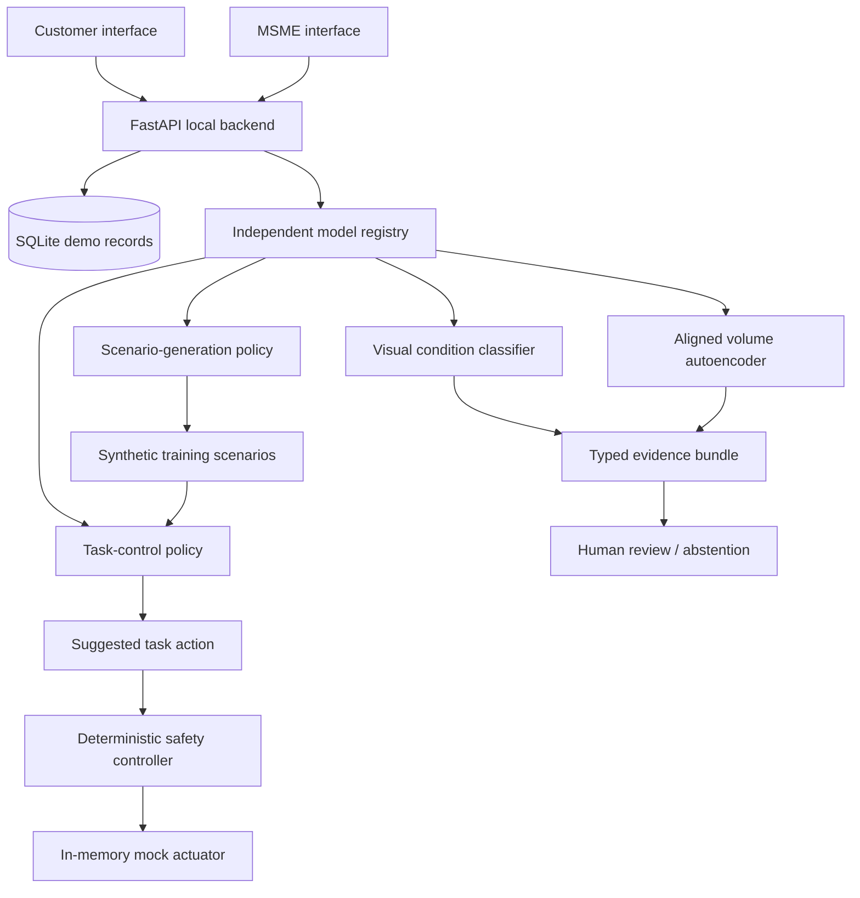

# System architecture

The HTTP inference route returns suggestions/evidence only. Mock execution requires a separate
authenticated request through the controller. No trained policy directly writes servo signals.
The firmware is a separate draft with an independent local arm/stop state machine.

## Model architecture choices
Visual: MobileNetV3 Small with a replaced classification head, pretrained ImageNet initialization,
validation-loss checkpoint selection, held-out classification report and input-gradient saliency.
This is a provisional lightweight baseline. Detection and multitask branches need additional labels.

Volume: two strided 3D convolutions and two transpose convolutions. Training minimizes MSE on
aligned 32³ volumes. Compare with a per-volume constant-mean baseline and inspect reconstruction.
It learns a compact representation; it does not recover missing acquisition geometry.

Scenario: PPO on a contextual one-step scenario-selection bandit. Ten actions choose a target and
disturbance tier. The reward favors solvable scenarios near a desired challenge against a frozen
rule controller. It is a deliberately limited learned curriculum, not a learned world simulator.

Robot: PPO MLP observes position, synthetic object target, category, perception confidence,
time, stop state and disturbance. It suggests left/hold/right. Training evaluates held-out seeds,
a deterministic rule baseline and a narrow-training PPO baseline under the same evaluation distribution.

## Data flow and evidence
Dataset manifests carry provenance and group splits. Model exports carry training/evaluation
metadata and file checksums. Model loading remains independent. Fusion keeps perception and
policy outputs separate and returns human review rather than a combined food-safety score.

## Business architecture
EDGE is a local deployment concept. ENTERPRISE requires identity, tenant isolation, migrations,
audited model promotion, monitoring, backups and billing. Those are roadmap items, not deployed features.
